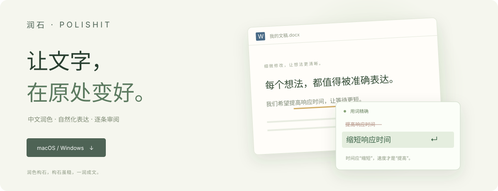

**思路继续向前，修改留在字里行间。**

[体验产品展示页](https://www.runshi.top/) · [润石官网](https://www.runshi.top/) · [波江座 NEO LAB](https://www.runshi.top/lab/)

 

## 下载润石

| macOS · Apple Silicon | Windows · x64 |
| :--- | :--- |
| [**下载 .dmg 安装包 ↓**](https://github.com/Choras4ai/polishit/releases/download/v1.7.0/runshi-polis-1.7.0-arm64.dmg) | [**下载 .exe 安装程序 ↓**](https://github.com/Choras4ai/polishit/releases/download/v1.7.0/runshi-polis-setup-1.7.0.exe) |
| 稳定版 1.7.0 · 约 135 MB | 稳定版 1.7.0 · 约 115 MB |

[历史版本与发布说明](https://github.com/Choras4ai/polishit/releases) · [校验安装包](https://www.runshi.top/#download) · [反馈问题](https://github.com/Choras4ai/polishit/issues/new)

macOS 安装包目前为临时签名，尚未 Apple 公证，首次安装可能受到系统拦截。Windows Word 原文浮窗尚待真机验收。网页演示为可操作的设计预览，实际能力取决于安装版本、系统权限与编辑器支持。

## 好工具懂得协助，也懂得保留

- **中文润色**：查看错别字、语句、用词和表达精炼等建议，逐条决定。
- **自然化表达**：减少套话和模板感，保留你的声音；不承诺任何检测器分数。
- **原文审阅**：在兼容编辑器中贴近原文查看修改方案；无法安全定位时，使用结果窗或复制流程。
- **自行选择服务**：可配置模型服务商；自配 API 与托管模式的数据路径不同，详见[隐私政策](https://www.runshi.top/privacy.html)。

[**打开交互演示：悬停查看理由 → 接受建议 → 撤销修改**](https://www.runshi.top/#compare)

## 开始使用

1. 下载并安装对应平台的稳定版。
2. 按应用引导配置服务；macOS 原文交互需要辅助功能权限。
3. 在编辑器中选中文字，通过浮窗或快捷键触发。macOS 默认 `⌘⌥V`，Windows 默认 `Ctrl+Alt+V`。
4. 查看建议，逐条接受或忽略；原文或文档变化后重新分析。

## 关于这个仓库

这是润石的**官方产品与安装包发布仓库**。桌面应用源代码现为私有；这里只维护官网跳转页、使用说明、反馈入口与正式安装包。

GitHub 自动提供的 **Source code (zip/tar.gz)** 仅打包本展示仓库的网页和说明，**不包含润石桌面应用源码**。请下载扩展名为 `.dmg` 或 `.exe` 的安装包。

开发测试版与稳定版分开管理；未验收的开发构建不会被当作正式更新推送。

---

**润色构石，构石虽糙，一润成文。**

[波江座人工智能 · NEO LAB](https://www.runshi.top/lab/) · [隐私政策](https://www.runshi.top/privacy.html) · [服务条款](https://www.runshi.top/terms.html)

[湘ICP备2026023017号-1](https://beian.miit.gov.cn/) · [湘公网安备43010402003011号](https://beian.mps.gov.cn/#/query/webSearch?code=43010402003011)

© 波江座人工智能 · 保留所有权利

